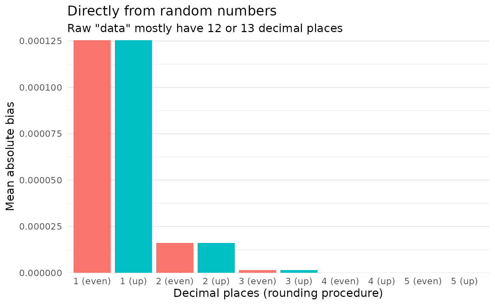
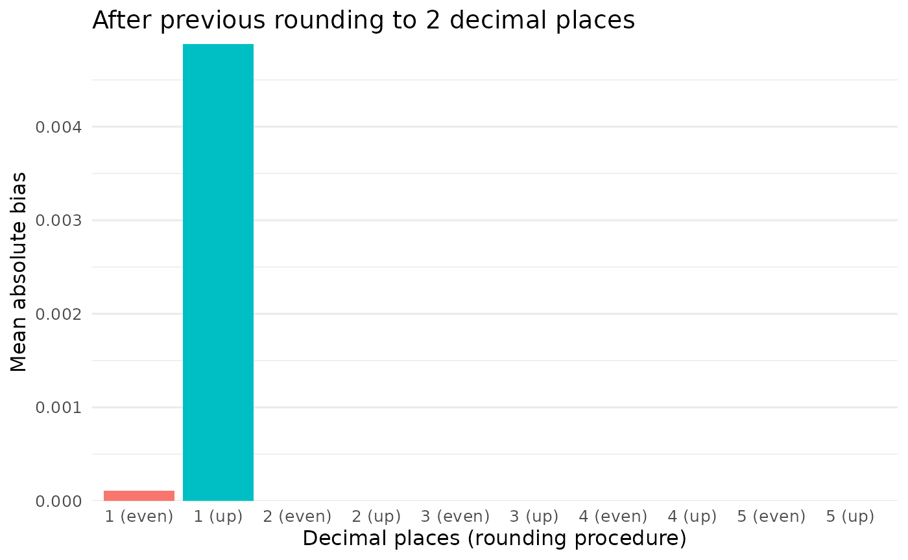

# Rounding in depth

``` r

library(roundwork)
```

Rounding is a more diverse and variegated topic than one might think.
“Rounding” is often taken to simply mean rounding up from 5, and
although that’s wrong, it doesn’t make much of a difference most of the
time.

One place where it does matter is in *reconstructing* the rounding
procedures that others used, claim to have used, or are alleged to have
used. In short, rounding and all its details matter for error detection.

This vignette goes into depth on roundwork’s infrastructure for
reconstructing rounding procedures and results from summary statistics.
All of that is essential for packages built on top of roundwork, such as
[scrutiny](https://lhdjung.github.io/scrutiny/): it is a precondition
for translating assumptions about the processes behind published summary
data into a few simple, higher-level function calls.

Feel free to skip the more theoretical parts if your focus is on the
code. See
[`vignette("rounding-options")`](https://lhdjung.github.io/roundwork/articles/rounding-options.md)
for a list of possible values of the `rounding` argument.

### Overview

Base R’s [`round()`](https://rdrr.io/r/base/Round.html) function is
surprisingly sophisticated. This distinguishes it from simpler rounding
procedures, such as rounding up from 5. For this very reason, however,
it can’t be used to reconstruct the rounding procedures of other
software programs. This is the job of roundwork’s rounding functions.

First, I will present
[`reround()`](https://lhdjung.github.io/roundwork/reference/reround.md),
a general interface to reconstructing rounded numbers, before going
through the individual rounding functions. I will also discuss
[`unround()`](https://lhdjung.github.io/roundwork/reference/unround.md),
which works the reverse way: It takes a rounded number and reconstructs
the bounds of the original number, taking details about the assumed
rounding procedure into account. Finally, I will take a closer look at
bias from rounding raw numbers.

### Reconstruct rounded numbers with `reround()`

Error detection techniques don’t usually call the individual rounding
functions directly. To reconstruct rounded numbers, they call
[`reround()`](https://lhdjung.github.io/roundwork/reference/reround.md),
which mediates between these two levels. To find the range of an
original number behind a reported one, they call
[`unround()`](https://lhdjung.github.io/roundwork/reference/unround.md)
or, in exact integer arithmetic,
[`bound_numerators()`](https://lhdjung.github.io/roundwork/reference/bound_numerators.md)
and
[`sum_range()`](https://lhdjung.github.io/roundwork/reference/sum_range.md);
see below.
[`reround()`](https://lhdjung.github.io/roundwork/reference/reround.md)
takes the vector of “raw” reconstructed numbers that were not yet
rounded in the way that’s assumed to have been the original rounding
procedure. Its next argument is `digits`, the number of decimal places
to round to.

The remaining three arguments are about the rounding procedure. Most of
the time, only `rounding` will be of any interest. It takes a string
with the name of one of the rounding procedures discussed below.

Here is an example for a
[`reround()`](https://lhdjung.github.io/roundwork/reference/reround.md)
call:

``` r

reround(x = c(5.812, 7.249), digits = 2, rounding = "up")
#> [1] 5.81 7.25
```

The two remaining arguments are `threshold`, which concerns the obscure
case of rounding from a number other than 5, and `symmetric`, which
decides how ties in negative numbers are broken. `symmetric` is not
obscure: with `symmetric = TRUE`, a negative number is rounded like its
absolute value, which is what Excel, SPSS, SAS, and Matlab all do. If
your data contain negative values and you commit to a single rounding
direction, this is the setting that separates those programs from Stata
and from “school math read literally on the number line”. See
[`vignette("rounding-options")`](https://lhdjung.github.io/roundwork/articles/rounding-options.md).

### Rounding procedures in detail

#### Up and down

[`round_up()`](https://lhdjung.github.io/roundwork/reference/rounding-common.md)
does what most people think of as rounding. If the decimal portion to be
cut off by rounding is 5 or greater, it rounds up. Otherwise, it rounds
down.

``` r

round_up(x = 1.24, digits = 1)
#> [1] 1.2

round_up(x = 1.25, digits = 1)
#> [1] 1.3

round_up(x = 1.25) # default for `digits` is 0
#> [1] 1
```

Rounding up from 5 is actually a special case of
[`round_up_from()`](https://lhdjung.github.io/roundwork/reference/rounding-common.md),
which can take any numeric threshold, not just 5:

``` r

round_up_from(x = 4.28, digits = 1, threshold = 9)
#> [1] 4.2

round_up_from(x = 4.28, digits = 1, threshold = 1)
#> [1] 4.3
```

These two functions have their mirror images in
[`round_down()`](https://lhdjung.github.io/roundwork/reference/rounding-common.md)
and
[`round_down_from()`](https://lhdjung.github.io/roundwork/reference/rounding-common.md).
The arguments are the same as in
[`round_up()`](https://lhdjung.github.io/roundwork/reference/rounding-common.md):

``` r

round_down(x = 1.24, digits = 1)
#> [1] 1.2

round_down(x = 1.25, digits = 1)
#> [1] 1.2

round_down(x = 1.25) # default for `digits` is 0
#> [1] 1
```

[`round_up_from()`](https://lhdjung.github.io/roundwork/reference/rounding-common.md)
rounds up when the part cut off by rounding is at least $`t`$ tenths of
a step, and
[`round_down_from()`](https://lhdjung.github.io/roundwork/reference/rounding-common.md)
rounds down when that part is at most $`t`$ tenths. With the same
threshold, the two switch direction at the same point:

``` r

round_down_from(x = 4.28, digits = 1, threshold = 9)
#> [1] 4.2

round_down_from(x = 4.28, digits = 1, threshold = 1)
#> [1] 4.3
```

They only differ for a value exactly on the threshold:

``` r

round_up_from(x = 4.25, digits = 1, threshold = 5)
#> [1] 4.3

round_down_from(x = 4.25, digits = 1, threshold = 5)
#> [1] 4.2
```

Rounding up implements this formula:

``` math
\frac{\lfloor x(10^d) +1 - \frac{t}{10} + \epsilon \rfloor}{10^d}
```

where $`x`$ is the number to be rounded, $`d`$ is the number of decimal
places to which $`x`$ should be rounded, and $`t`$ is the threshold for
rounding up (e.g., $`t = 5`$ for rounding up from 5). Note that
$`\lfloor n \rfloor`$ floors a number $`n`$, and $`\lceil n \rceil`$
ceils it.

Rounding down works accordingly:

``` math
\frac{\lceil x(10^d) - \frac{t}{10} - \epsilon \rceil}{10^d}
```

The $`\epsilon`$ in both formulas is a fixed tolerance of about
$`1.5 \times 10^{-9}`$. It is there because shifting $`x`$ by $`d`$
decimal places is not exact: $`0.145 \times 100`$ is stored as
$`14.499999999999998`$, a hair below the tie it is meant to be, and
rounding that shifted value directly would move $`0.145`$ a whole step
in the wrong direction. The same tolerance is applied by every other
`round_*()` function, and
[`unround()`](https://lhdjung.github.io/roundwork/reference/unround.md)
reports bounds that assume it, so a number and its reconstructed range
always agree. See the `Floating-point tolerance` section of
[`round_up()`](https://lhdjung.github.io/roundwork/reference/rounding-common.md).

#### Ties, named directly

[`round_up()`](https://lhdjung.github.io/roundwork/reference/rounding-common.md)
and
[`round_down()`](https://lhdjung.github.io/roundwork/reference/rounding-common.md)
say which way a tie goes *on the number line*, and `symmetric` then
decides what that means below zero. Since that translation is easy to
get backwards, the same procedures are also available under names that
state them outright:

``` r

round_ties_up(-2.5)     # Stata
#> [1] -2
round_ties_down(-2.5)
#> [1] -3
round_ties_away(-2.5)   # Excel, SPSS, SAS, Matlab
#> [1] -3
round_ties_zero(-2.5)
#> [1] -2
round_ties_even(-2.5)   # `base::round()`
#> [1] -2
```

[`round_ties_up()`](https://lhdjung.github.io/roundwork/reference/rounding-ties.md)
is
[`round_up()`](https://lhdjung.github.io/roundwork/reference/rounding-common.md)
with `symmetric = FALSE`, and
[`round_ties_away()`](https://lhdjung.github.io/roundwork/reference/rounding-ties.md)
is
[`round_up()`](https://lhdjung.github.io/roundwork/reference/rounding-common.md)
with `symmetric = TRUE`. Nothing is deprecated by them; use whichever
spelling reads better. The `rounding` strings `"ties_up"`,
`"ties_down"`, `"ties_away"`, `"ties_zero"`, and `"ties_even"` name the
same procedures inside
[`reround()`](https://lhdjung.github.io/roundwork/reference/reround.md)
and
[`unround()`](https://lhdjung.github.io/roundwork/reference/unround.md).
Each of them already determines the direction of a tie for negative
numbers as well, so combining them with `symmetric = TRUE` is an error.

#### To even (base R)

Like Python’s
[`round()`](https://docs.python.org/3/builtins/functions.html#round)
function, R’s [`base::round()`](https://rdrr.io/r/base/Round.html)
doesn’t round up or down, or use any other procedure based solely on the
truncated part of the number. Instead,
[`round()`](https://rdrr.io/r/base/Round.html) strives to round to the
next even number. This is also called “banker’s rounding”, and it
follows a technical standard, [IEEE
754](https://en.wikipedia.org/wiki/IEEE_754#Roundings_to_nearest).

Realizing that [`round()`](https://rdrr.io/r/base/Round.html) works in a
highly unintuitive way sometimes leads to consternation. Why can’t we
just round like we learned in school, that is, up from 5? The reason
seems to be bias. Because 5 is right in between two whole numbers, any
procedure that rounds 5 in some predetermined direction introduces a
bias toward that direction. Rounding up from 5 is therefore biased
upward, and rounding down from 5 is biased downward.

As shown in the *Rounding bias* section below, this is unlikely to be a
major issue when rounding raw numbers that originally have many decimal
places. It might be more serious, however, if the initial number of
decimal places is low (for whatever reason) and the need for precision
is high.

At least in theory, “rounding to even” is not biased in either
direction, and it preserves the mean of the original distribution. That
is how [`round()`](https://rdrr.io/r/base/Round.html) aims to operate.
Here is a case in which it works out, whereas the bias of rounding up or
down is fully apparent:

``` r

vec1 <- seq(from = 0.5, to = 9.5)
up1 <- round_up(vec1)
down1 <- round_down(vec1)
even1 <- round(vec1)

vec1
#>  [1] 0.5 1.5 2.5 3.5 4.5 5.5 6.5 7.5 8.5 9.5
up1
#>  [1]  1  2  3  4  5  6  7  8  9 10
down1
#>  [1] 0 1 2 3 4 5 6 7 8 9
even1
#>  [1]  0  2  2  4  4  6  6  8  8 10

# Original mean
mean(vec1)
#> [1] 5

# Means when rounding up or down: bias!
mean(up1)
#> [1] 5.5
mean(down1)
#> [1] 4.5

# Mean when rounding to even: no bias
mean(even1)
#> [1] 5
```

However, unbiased in theory does not mean unbiased in every sample.
Rounding to even only preserves the mean if the even neighbors fall
equally often above and below the ties. Here, all values are exact ties,
but four of the seven have their even neighbor below:

``` r

vec2 <- seq(from = 4.5, to = 10.5)

up2 <- round_up(vec2)
down2 <- round_down(vec2)
even2 <- round(vec2)

vec2
#> [1]  4.5  5.5  6.5  7.5  8.5  9.5 10.5
up2
#> [1]  5  6  7  8  9 10 11
down2
#> [1]  4  5  6  7  8  9 10

even2 # Every tie goes to even...
#> [1]  4  6  6  8  8 10 10

mean(vec2)
#> [1] 7.5
mean(up2)
#> [1] 8
mean(down2)
#> [1] 7
mean(even2) # ... but the mean is biased downward!
#> [1] 7.428571
```

Floating-point arithmetic adds a second complication. Most decimal
fractions cannot be represented exactly in binary, so numbers that look
like ties usually are not.
[`round()`](https://rdrr.io/r/base/Round.html) then rounds them to the
nearer neighbor, even or not. Below, `1.15` goes to `1.1` and `1.85` to
`1.9`:

``` r

vec3 <- c(
  1.05,
  1.15,
  1.25,
  1.35,
  1.45,
  1.55,
  1.65,
  1.75,
  1.85,
  1.95
)

# Still, the mean is preserved here:
round(vec3, 1)
#>  [1] 1.0 1.1 1.2 1.4 1.4 1.6 1.6 1.8 1.9 2.0
mean(vec3)
#> [1] 1.5
mean(round(vec3, 1))
#> [1] 1.5
```

Sometimes [`round()`](https://rdrr.io/r/base/Round.html) behaves just as
it should, but at other times, results can be hard to explain. Martin
Mächler, who wrote the present version of
[`round()`](https://rdrr.io/r/base/Round.html), [describes the
issue](https://rpubs.com/maechler/Rounding) about as follows:

The reason for the above behavior is that most decimal fractions can’t,
in fact, be represented as double precision numbers. Even seemingly
“clean” numbers with only a few decimal places come with a long
invisible mantissa, and are therefore closer to one side or the other.
(To see this clearly, try entering a few decimal numbers on [Float
Exposed](https://float.exposed).)

We usually think that rounding rules are all about breaking a tie that
occurs at 5. Most floating-point numbers, however, are just somewhat
less than or greater than 5. There is no tie! Consequently, Mächler
says, rounding functions need to “*measure, not guess* which of the two
possible decimals is closer to `x`” — and therefore, which way to round.

This seems better than following mathematical intuitions that may not
always correspond to the way computers actually deal with numbers. R has
used the present solution since version 4.0.0.

[`base::round()`](https://rdrr.io/r/base/Round.html) can seem like a
black box, but it seems unbiased in the long run. I recommend using
[`round()`](https://rdrr.io/r/base/Round.html) for original work.

For reconstruction, two claims about
[`round()`](https://rdrr.io/r/base/Round.html) are easy to run together.
[`base::round()`](https://rdrr.io/r/base/Round.html) is the right way to
reconstruct software that rounds binary doubles to even, such as R
itself, Python, and NumPy. This is what `rounding = "even"` does. What
is unsuitable is the reverse: Predicting
[`round()`](https://rdrr.io/r/base/Round.html)’s output from the decimal
you see written down, since most decimals are not exactly representable
and so are not really ties at all. Reconstructing the many programs that
do round from the decimal 5 is the job of roundwork’s other `round_*()`
functions. See
[`vignette("rounding-options")`](https://lhdjung.github.io/roundwork/articles/rounding-options.md),
which lists which program falls on which side.

#### IEEE 754 rounding standard

If you need to follow the IEEE 754 rounding standard, see
[`round_ties_to_even()`](https://lhdjung.github.io/roundwork/reference/ieee-754.md)
for wrapper functions that implement all five IEEE rounding procedures
(or “rounding-direction attributes”). IEEE 754 defines standards for
floating-point operations, which includes rounding (IEEE 2019, pp. 27f.;
the [Wikipedia
page](https://en.wikipedia.org/wiki/IEEE_754#Rounding_rules) is more
accessible).

Each of them is a wrapper around a function that roundwork already had
under a name of its own:

| IEEE 754 function | Equivalent |
|----|----|
| [`round_ties_to_even()`](https://lhdjung.github.io/roundwork/reference/ieee-754.md) | [`base::round()`](https://rdrr.io/r/base/Round.html) |
| [`round_ties_to_away()`](https://lhdjung.github.io/roundwork/reference/ieee-754.md) | [`round_ties_away()`](https://lhdjung.github.io/roundwork/reference/rounding-ties.md), i.e. [`round_up()`](https://lhdjung.github.io/roundwork/reference/rounding-common.md) with `symmetric = TRUE` |
| [`round_toward_positive()`](https://lhdjung.github.io/roundwork/reference/ieee-754.md) | [`round_ceiling()`](https://lhdjung.github.io/roundwork/reference/rounding-uncommon.md) |
| [`round_toward_negative()`](https://lhdjung.github.io/roundwork/reference/ieee-754.md) | [`round_floor()`](https://lhdjung.github.io/roundwork/reference/rounding-uncommon.md) |
| [`round_toward_zero()`](https://lhdjung.github.io/roundwork/reference/ieee-754.md) | [`round_trunc()`](https://lhdjung.github.io/roundwork/reference/rounding-uncommon.md) |

The duplication is deliberate. roundwork’s own names were chosen without
the standard in mind, and renaming them would break every downstream
caller; but a function that says *roundTowardPositive* on the tin is
easier to reach for when a paper or a manual states its rounding in the
standard’s vocabulary. Note that the standard has no name for the other
three tie-breaking procedures, for rounding away from zero
([`round_anti_trunc()`](https://lhdjung.github.io/roundwork/reference/rounding-uncommon.md)),
or for the custom thresholds of
[`round_up_from()`](https://lhdjung.github.io/roundwork/reference/rounding-common.md).

### Reconstruct rounding bounds with `unround()`

Rounding leads to a loss of information. The mantissa is cut off in part
or in full, and the resulting number is underdetermined with respect to
the original number: The latter can’t be inferred from the former. It
might be of interest, however, to compute the range of the original
number given the rounded number (especially the number of decimal places
to which it was rounded) and the presumed rounding method.

While it’s often easy to infer such a range, we better have the computer
do it. Enter
[`unround()`](https://lhdjung.github.io/roundwork/reference/unround.md).
It returns the lower and upper bounds, and it says whether these bounds
are inclusive or not — something that varies greatly by rounding
procedure. These are the same bounds that a consistency test derives its
candidate values from.

The default rounding procedure for
[`unround()`](https://lhdjung.github.io/roundwork/reference/unround.md)
is `"up_or_down"`:

``` r

unround(x = "8.0")
#> # A tibble: 1 × 7
#>   range                  rounding   lower incl_lower x     incl_upper upper
#>   <chr>                  <chr>      <dbl> <lgl>      <chr> <lgl>      <dbl>
#> 1 7.95 <= x(8.0) <= 8.05 up_or_down  7.95 TRUE       8.0   TRUE        8.05
```

For a complete list of featured rounding procedures, see documentation
for
[`unround()`](https://lhdjung.github.io/roundwork/reference/unround.md),
section *Rounding*.

On the left, the `range` column displays a pithy graphical overview of
the other columns (except for `rounding`) in the same order:

1.  `lower` is the lower bound for the original number.
2.  `incl_lower` is `TRUE` if the lower bound is inclusive and `FALSE`
    otherwise.
3.  `x` is the input value.
4.  `incl_upper` is `TRUE` if the upper bound is inclusive and `FALSE`
    otherwise.
5.  `upper` is the upper bound for the original number.

By default, decimal places are counted internally so that the function
always operates on the appropriate decimal level. This creates a need to
take trailing zeros into account, which is why `x` needs to be a string:

``` r

unround(x = "3.50", rounding = "up")
#> # A tibble: 1 × 7
#>   range                    rounding lower incl_lower x     incl_upper upper
#>   <chr>                    <chr>    <dbl> <lgl>      <chr> <lgl>      <dbl>
#> 1 3.495 <= x(3.50) < 3.505 up        3.50 TRUE       3.50  FALSE       3.50
```

Alternatively, a function that uses
[`unround()`](https://lhdjung.github.io/roundwork/reference/unround.md)
as a helper might count decimal places by itself. It should then pass
these numbers to
[`unround()`](https://lhdjung.github.io/roundwork/reference/unround.md)
via the `digits` argument instead of letting it redundantly count
decimal places a second time.

In this case, `x` can be numeric because trailing zeros are no longer
needed. (That, in turn, is because the responsibility to count decimal
places in number-strings rather than numeric values shifts from
[`unround()`](https://lhdjung.github.io/roundwork/reference/unround.md)
to the higher-level function.)

The following call returns the same bounds as above. Only the `x` column
differs, since it is now a number rather than a string:

``` r

unround(x = 3.5, digits = 2, rounding = "up")
#> # A tibble: 1 × 7
#>   range                   rounding lower incl_lower     x incl_upper upper
#>   <chr>                   <chr>    <dbl> <lgl>      <dbl> <lgl>      <dbl>
#> 1 3.495 <= x(3.5) < 3.505 up        3.50 TRUE         3.5 FALSE       3.50
```

Since `x` is vectorized, you might test several reported numbers at
once:

``` r

vec4 <- c("2.0", "3.1", "3.5")

vec4 |>
  unround(rounding = "even")
#> # A tibble: 3 × 7
#>   range                  rounding lower incl_lower x     incl_upper upper
#>   <chr>                  <chr>    <dbl> <lgl>      <chr> <lgl>      <dbl>
#> 1 1.95 <= x(2.0) <= 2.05 even      1.95 TRUE       2.0   TRUE        2.05
#> 2 3.05 <= x(3.1) <= 3.15 even      3.05 TRUE       3.1   TRUE        3.15
#> 3 3.45 <= x(3.5) <= 3.55 even      3.45 TRUE       3.5   TRUE        3.55
```

#### Bounds as exact integers

Deriving a set of candidate values from the decimal bounds above is
unsafe. If a product such as `floor(upper * n)` is mathematically an
exact integer, its `double` representation can fall on either side of
it, so a legitimate candidate may be silently dropped or a phantom one
admitted — and a consistency verdict can flip either way.

[`bound_numerators()`](https://lhdjung.github.io/roundwork/reference/bound_numerators.md)
therefore returns the same bounds as exact integer numerators over a
common denominator, which turns every such comparison into one between
integers:

``` r

bound_numerators(
  x_num = 2.7,
  digits = 1,
  rounding = "up_or_down",
  threshold = 5,
  symmetric = FALSE
)
#> $lower
#> [1] 265
#> 
#> $upper
#> [1] 275
#> 
#> $denom
#> [1] 100
#> 
#> $incl_lower
#> [1] TRUE
#> 
#> $incl_upper
#> [1] TRUE
```

[`sum_range()`](https://lhdjung.github.io/roundwork/reference/sum_range.md)
builds on these numerators. It returns the least and the greatest
whole-number sum that, divided by `n_items` and rounded, gives the
reported mean — the arithmetic behind GRIM. A mean of 5.18 from 28 whole
numbers requires their sum to be 145:

``` r

sum_range(
  x_num = 5.18,
  n_items = 28,
  digits = 2,
  rounding = "up_or_down",
  threshold = 5
)
#> [1] 145 145
```

These are the low-level entry points that consistency tests build on.
Most users want
[`unround()`](https://lhdjung.github.io/roundwork/reference/unround.md)
instead.

### Fractional rounding

What if you want to round numbers to a fraction instead of an integer?
Check out
[`reround_to_fraction()`](https://lhdjung.github.io/roundwork/reference/fractional-rounding.md)
and
[`reround_to_fraction_level()`](https://lhdjung.github.io/roundwork/reference/fractional-rounding.md):

``` r

reround_to_fraction(x = 0.4, denominator = 2, rounding = "up")
#> [1] 0.5
```

This function rounds `0.4` to `0.5` because that’s the closest fraction
of `2`. It is inspired by `janitor::round_to_fraction()`, and credit for
the core implementation goes there.
[`reround_to_fraction()`](https://lhdjung.github.io/roundwork/reference/fractional-rounding.md)
blends janitor’s fractional rounding with the flexibility and precision
that
[`reround()`](https://lhdjung.github.io/roundwork/reference/reround.md)
provides.

What’s more,
[`reround_to_fraction_level()`](https://lhdjung.github.io/roundwork/reference/fractional-rounding.md)
rounds to the nearest fraction at the decimal level specified via its
`digits` argument:

``` r

reround_to_fraction_level(
  x = 0.777,
  denominator = 5,
  digits = 0,
  rounding = "down"
)
#> [1] 0.8
reround_to_fraction_level(
  x = 0.777,
  denominator = 5,
  digits = 1,
  rounding = "down"
)
#> [1] 0.78
reround_to_fraction_level(
  x = 0.777,
  denominator = 5,
  digits = 2,
  rounding = "down"
)
#> [1] 0.776
```

### Rounding bias

I wrote above that rounding up or down from 5 is biased. However, this
points to a wider problem: It is true of any rounding procedure that
doesn’t take active precautions against such bias.
[`base::round()`](https://rdrr.io/r/base/Round.html) does, and that is
why I recommend it for original work (as opposed to reconstruction).

It might be useful to have a general and flexible way to quantify how
far rounding biases a distribution, as compared to how it looked like
before rounding. The function
[`rounding_bias()`](https://lhdjung.github.io/roundwork/reference/rounding_bias.md)
fulfills this role. It is a wrapper around
[`reround()`](https://lhdjung.github.io/roundwork/reference/reround.md),
so it can access any rounding procedure that
[`reround()`](https://lhdjung.github.io/roundwork/reference/reround.md)
can, and takes all of the same arguments. However, the default for
`rounding` is `"up"` instead of `"up_or_down"` because
[`rounding_bias()`](https://lhdjung.github.io/roundwork/reference/rounding_bias.md)
only makes sense with single rounding procedures.

In general, bias due to rounding is computed by subtracting the original
distribution from the rounded one:

``` math
bias = x_{rounded} - x
```

By default, the mean is computed to reduce the bias to a single data
point:

``` r

vec5 <- seq(from = 0.6, to = 0.7, by = 0.01)

vec5
#>  [1] 0.60 0.61 0.62 0.63 0.64 0.65 0.66 0.67 0.68 0.69 0.70

# The mean before rounding...
mean(vec5)
#> [1] 0.65

# ...is not the same as afterwards...
mean(round_up(vec5))
#> [1] 1

# ...and the difference is bias:
rounding_bias(x = vec5, digits = 0, rounding = "up")
#> [1] 0.35
```

Set `mean` to `FALSE` to return the whole vector of individual biases
instead:

``` r

rounding_bias(x = vec5, digits = 0, rounding = "up", mean = FALSE)
#>  [1] 0.40 0.39 0.38 0.37 0.36 0.35 0.34 0.33 0.32 0.31 0.30
```

Admittedly, this example is somewhat overdramatic. Here is a rather
harmless one:

``` r

set.seed(42)
vec6 <- rnorm(50000, 100, 15)

rounding_bias(vec6, digits = 2)
#> [1] -1.61016e-05
```

What is responsible for such a difference? It seems to be (1) the sample
size and (2) the number of decimal places to which the vector is
rounded. The rounding method doesn’t appear to matter if numbers with
many decimal places are rounded:

    #> # A tibble: 10 × 3
    #>            bias decimal_digits rounding
    #>           <dbl> <chr>          <chr>   
    #>  1 0.000126     1 up           up      
    #>  2 0.0000161    2 up           up      
    #>  3 0.00000150   3 up           up      
    #>  4 0.0000000104 4 up           up      
    #>  5 0.0000000104 5 up           up      
    #>  6 0.000126     1 even         even    
    #>  7 0.0000161    2 even         even    
    #>  8 0.00000150   3 even         even    
    #>  9 0.0000000104 4 even         even    
    #> 10 0.0000000104 5 even         even



However, if the raw values are preliminarily rounded to 2 decimal places
before rounding proceeds as above, the picture is different:

    #> # A tibble: 10 × 3
    #>        bias decimal_digits rounding
    #>       <dbl> <chr>          <chr>   
    #>  1 0.00488  1 up           up      
    #>  2 0        2 up           up      
    #>  3 0        3 up           up      
    #>  4 0        4 up           up      
    #>  5 0        5 up           up      
    #>  6 0.000109 1 even         even    
    #>  7 0        2 even         even    
    #>  8 0        3 even         even    
    #>  9 0        4 even         even    
    #> 10 0        5 even         even



In sum, the function allows users to quantify the degree to which
rounding biases a distribution, so that they can assess the relative
merits of different rounding procedures. This is partly to sensitize
readers to potential bias in edge cases, but also to enable them to make
informed rounding decisions on their own.

#### Citation dummy

*(Here is an extra section. Its display is suppressed via the CSS
element `display: none;` because its only purpose is to generate the
citation IEEE (2019) — I want to style the citation in the text above
more flexibly than the format allows (without parentheses) but still get
the reference pasted at the bottom.)*

## References

IEEE. 2019. *IEEE Standard for Floating-Point Arithmetic*.
<https://doi.org/10.1109/IEEESTD.2019.8766229>.
